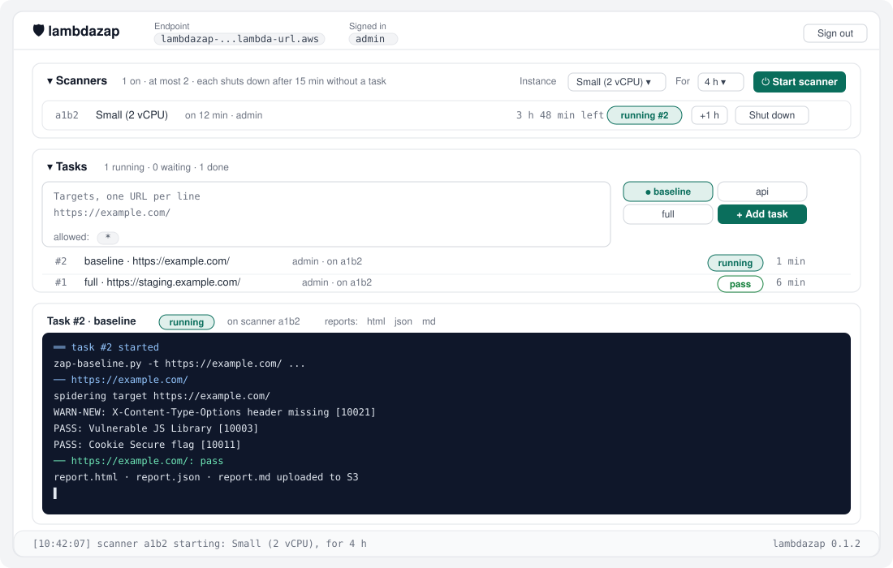
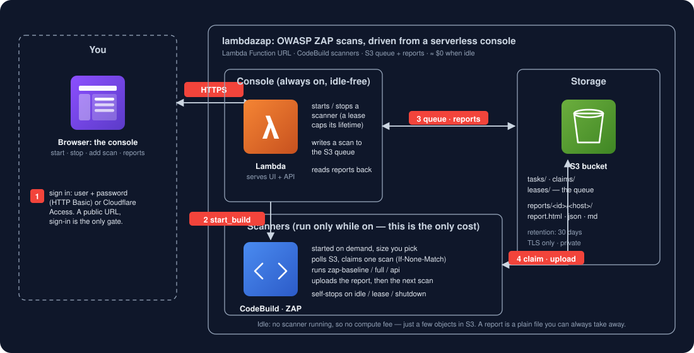

# lambdazap

**OWASP ZAP scans of your own sites from a web UI on a Lambda Function URL — scanners are CodeBuild instances you
start and shut down like machines, ≈ $0 while none is on.** Part of [IdleFree](https://cloudformer.github.io/) · 中文：[README.zh.md](README.zh.md)

Pick a size and a duration, start a scanner (ready in about a minute), start more if you want. Add tasks: one or
more URLs and a mode each; any free scanner takes the next one. The console follows a task's log live and links its
reports (HTML, JSON, Markdown) when it finishes. Shut a scanner down when done; it also shuts down by itself when
its time is up or after 10 minutes without a task. Only hosts on the allowlist can be scanned — set `allowed_targets`
to `["*"]` to turn the allowlist off and scan any host (sign-in is then the only gate).

| | |
|---|---|
| Web UI + API | one Lambda behind a Function URL; sign-in with a password or Cloudflare Access |
| Scanners | one CodeBuild build each, on a fresh instance; take the queued tasks (S3) in order, one at a time |
| Image | the official ZAP image, unchanged, plus the scan runner; in your ECR |
| Reports | S3, presigned download links, expire after `report_retention_days` |
| Secrets | SSM SecureStrings, set outside Terraform; masked as `***` in the log |
| Idle cost | ≈ $0 while no scanner is on (CodeBuild bills per minute while one is) |

## Modes

| Mode | ZAP script | What it does |
|---|---|---|
| `baseline` | `zap-baseline.py` | passive: spiders the site and reports what the responses show; nothing is attacked |
| `full` | `zap-full-scan.py` | active: spiders, then attacks every page found — only on sites you own |
| `api` | `zap-api-scan.py` | active, from an OpenAPI definition: the target is the definition's URL |

## Deploy

With the Terraform module — usage, variables and outputs:
[cloudformer/infra/aws//modules/lambdazap](https://registry.terraform.io/modules/cloudformer/infra/aws/latest/submodules/lambdazap).
Docker must be running where Terraform runs: it builds the scan image and pushes it to ECR.

## Scan only what you may scan

Scanning a site you are not authorized to test may be illegal. The allowlist (`allowed_targets`) is checked before
any scan starts; keep it to hosts you own or have written permission to test.

## License

MIT
