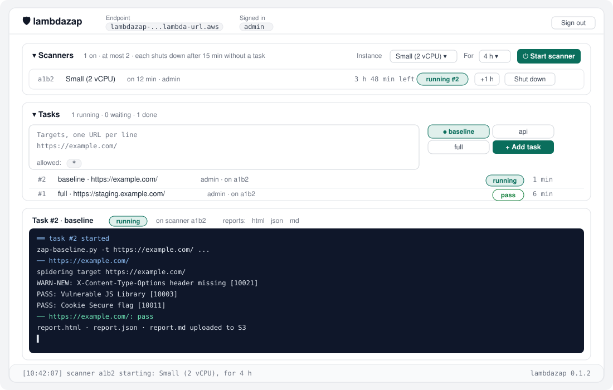
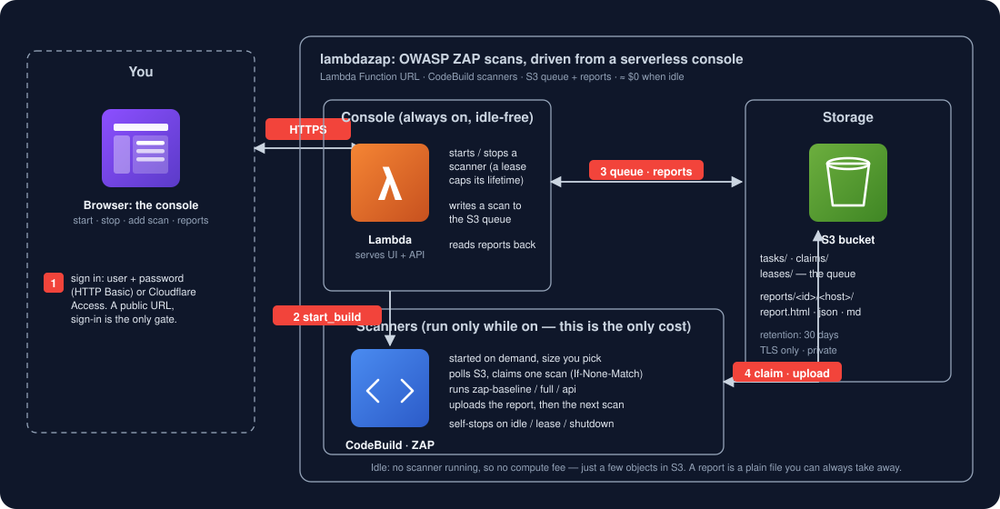

# lambdazap

**在 Lambda Function URL 的网页上，用 OWASP ZAP 扫描你自己的站点。扫描机是 CodeBuild 实例，像电脑一样手动开关，全部关机时 ≈ $0。**
[IdleFree](https://cloudformer.github.io/) 系列 · English: [README.md](README.md)

选机型和时长，开一台扫描机（约一分钟就绪），需要可以再开几台。添加任务：每个任务填一个或多个 URL、选一个模式；
哪台机器空了就接下一个。console 实时显示任务的日志，扫完后给出报告链接（HTML、JSON、Markdown）。用完点关机，
时长用完或空闲 10 分钟也会自动关机。只有允许清单里的主机可以扫描——把 `allowed_targets` 设成 `["*"]` 即可关闭清单、
扫描任意主机（此时登录是唯一的闸门）。

| | |
|---|---|
| 网页 + API | 一个 Lambda，Function URL；用密码或 Cloudflare Access 登录 |
| 扫描机 | 每台一个 CodeBuild build，新实例；按顺序领取队列（S3）里的任务，一次一个 |
| 镜像 | 官方 ZAP 镜像，不改动，加上扫描脚本；放在你的 ECR |
| 报告 | S3，预签名下载链接，`report_retention_days` 天后删除 |
| 登录（任务级） | 每个任务可带 Cookie、JWT、Cloudflare Access 令牌或自定义头，扫描即在登录态下进行；日志里脱敏，API 不返回 |
| 密钥 | SSM SecureString，在 Terraform 之外设置；日志里显示为 `***` |
| 空闲费用 | 全部关机时 ≈ $0（CodeBuild 按开机的分钟计费） |

## 模式

| 模式 | ZAP 脚本 | 做什么 |
|---|---|---|
| `baseline` | `zap-baseline.py` | 被动：爬取站点，报告响应里能看出的问题；不发起攻击 |
| `full` | `zap-full-scan.py` | 主动：爬取后攻击找到的每个页面，只用于你自己的站点 |
| `api` | `zap-api-scan.py` | 主动，基于 OpenAPI 定义：目标填定义文件的 URL |

## 部署

用 Terraform module，用法、变量和输出见
[cloudformer/infra/aws//modules/lambdazap](https://registry.terraform.io/modules/cloudformer/infra/aws/latest/submodules/lambdazap)。
运行 Terraform 的机器上要开着 Docker：它会构建扫描镜像并推到 ECR。

## 只扫描你有权扫描的目标

扫描未经授权的站点可能违法。允许清单（`allowed_targets`）在扫描开始前检查；只放你自己的，或有书面授权的主机。

## License

MIT
