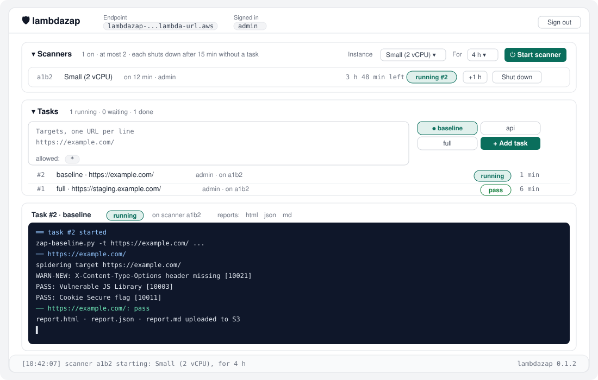
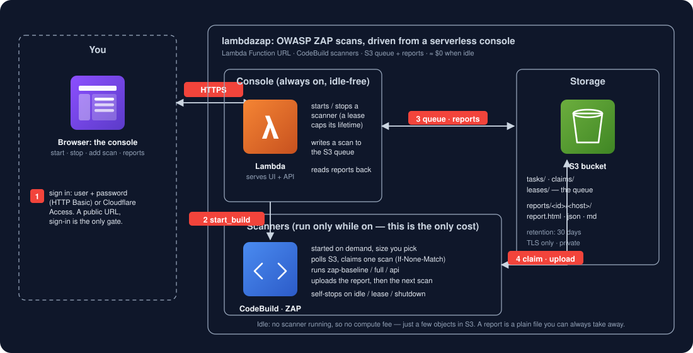

# lambdazap

**OWASP ZAP scans of your own sites from a web UI on a Lambda Function URL — scanners are CodeBuild instances you
start and shut down like machines, ≈ $0 while none is on.** Part of [IdleFree](https://cloudformer.github.io/).

This package holds the service: the Lambda (web UI + API) and the scan image's build context (official ZAP + the
scanner loop). Deploy it with the Terraform module
[cloudformer/infra/aws//modules/lambdazap](https://registry.terraform.io/modules/cloudformer/infra/aws/latest/submodules/lambdazap),
which installs this package from PyPI. Project: [cloudformer/lambdazap](https://github.com/cloudformer/lambdazap).
